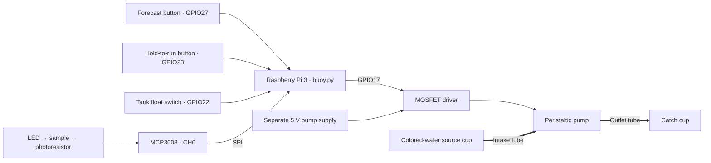

# Build a tabletop rain-response buoy

[Open the interactive buoy explorer](https://bluestechs.github.io/buoy-robot/).

The site is hosted on GitHub Pages from the root of the `main` branch. `index.html` opens `demo.html`, the explorer; `parts.html` is the parts catalog. `solution.html` presents the kids' proposed algae-bloom solution. Everything is static files and client-side JavaScript — no server code, build step, accounts, or secrets. Pushing an update to `main` republishes the site.

Put the Pi and breadboard on a dry LEGO base next to a shallow catch tray. Use two clear cups to show the tanks from the team's sketch. One holds plain water for display. The other holds water with a drop of food coloring and feeds the pump. The pump moves colored water into a clear catch cup, where everyone can see the result. Use a forecast button to stand in for the weather network and a light sensor to read a separate sample cup.

## The kids' big idea

Read [Proposed by the kids](solution.html) for their original problem statement and proposed solutions. They did the work. This site visualizes their idea further. The prototype does not test or recommend treating a real waterway.

## Try the simulator

The opening play page targets ages 7–10. A student picks one of three missions, guesses whether the pump will run, and takes a step to test the prediction. The four switches control rain, a cloudy water sample, the water tank, and hold-to-run permission. Visible feedback shows the current weather and a moving LEGO flag. The mission checks the real controller state. Answers and scores are not stored.

Start over resets the mission to rain, water present, and Run held. A ready-made scene selector is available inside **Try a ready-made scene**. Manual switches remain available. **Play** advances one simulated second at a time after the first prediction; **Next step** pauses and advances once. Each pulse lasts two simulated seconds.

Below the controls, an outdoor buoy cutaway sits beside its dry LEGO SPIKE equivalent. Select a component on either model to open a short child-first explanation and **Watch it move**. The demonstration does not change the simulator. Python excerpts, SPIKE-style blocks, costs and terminology remain available inside **For mentors**. These illustrate the logic, not a complete executable program. Close the part window with its close button or Escape.

The muted blue presentation uses a light theme regardless of the operating system setting. Discussion prompts and the prototype parts budget expand below the models. The outdoor device is an imagined design, not a tested product. Prototype costs exclude outdoor solar power and weatherproofing.

Each animation now has three named steps and enlarged close-ups under both device views. Small movements are exaggerated so the class can follow the action. Use **Stop animation** to stop early or **Replay animation** after it finishes. The final caption stays visible for discussion. Reduced-motion settings keep the explanations and static state changes. LEGO parts use distinct kit shapes and names: Large Hub, Color Sensor on A, Distance Sensor on B, and Medium Angular Motor on C. The model spaces parts out for clarity; it is not an assembly or wiring guide.

Select a part on either model to compare its job: **green** marks the part you picked and **blue** marks its match in the other model. A dotted line connects the pair around the diagrams, clear of the explanation text. The “Same job” sentence explains the shared idea, such as the hold-to-run button and the Hub's right button both giving permission to run. They share a role, not necessarily the same hardware or measurement method.

**Meet the parts** is an invitation strip on the explorer linking to the [parts catalog](parts.html). Each catalog entry starts with a photo, a short job description, and a LEGO equivalent. Open its mentor section for code, costs, terminology and source credits. The **Word helper** collects all definitions.

On the explorer, select a model component to open its details between the two devices. Both devices stay visible during the animation. On smaller screens, the outdoor model, details and LEGO model stack without overlap. Green marks the selected part and blue its counterpart, with labels that do not rely on color alone. Photos live in `images/` as ordinary static files. Photo credits link to Adafruit or AceCrew.

Open [demo.html](demo.html) through a simple static server or the GitHub Pages site. No installation or backend is needed. For a local preview, run `python3 -m http.server 8765` in this directory, then open `http://127.0.0.1:8765/`. Choose a mission, make a prediction and click **Next step**. **Play** advances automatically once per second; **Pause** freezes the simulation for discussion. **Start over** returns the mission to time zero. Changing scenarios also stops playback and resets the controller.

For a classroom presentation:

1. Choose **Presentation view** for a larger stage with the hardware details hidden. Use **Exit presentation** to return to the full page. This changes the page layout, not the browser's fullscreen setting.
2. Expand **Discussion prompts for grades 5–7**, then choose Grade 5, 6, or 7. Grade 5 asks students to predict observations, Grade 6 explores the control rules, and Grade 7 asks about evidence, safety checks, and event memory.
3. Read the question before running the scenario. Take steps together, watch the pump status and countdown, then select **Reveal explanation**. Each scenario has its own questions; changing grade or scenario hides the explanation again.
4. Try **Heavy rain**: the pump starts at 1 second and stops at 3 seconds. Then try **Tank runs low** or **Run button released**: the pump stops early at 2 seconds.

Choose **Set inputs manually** to change the four inputs independently before taking a step. Checkbox changes take effect at the next step. Reset restores the manual inputs to clear weather, clear sample, water present, and Run held. Select a part button to highlight it in the diagram and compare the Raspberry Pi and LEGO SPIKE Prime versions. All controls work with the keyboard, and the animation respects reduced-motion settings. Playback pauses when the browser tab is hidden.

The page simulates the controller in JavaScript and runs independently of the Python program and hardware. The diagram shows food-colored water moving into a catch cup; cloudiness alone is not evidence of algae.

From the project folder, run the interactive development simulator in a terminal:

```sh
python3 buoy.py --interactive
```

This mode uses the same Python controller as the Pi. Type `rain`, `cloudy`, `tank`, or `run` to flip that input. Press **Enter** on a blank line or type `step` to advance one simulated second. Type `quit` or press **Ctrl+C** to exit. Try this sequence:

1. Type `rain`, then `step`. The pump starts.
2. Type `tank`, then `step`. The controller stops the pump because the tank is low.
3. Type `tank`, then `step`. The tank is full again, but the same rain event has already used its pulse.
4. Type `rain`, then `step` to clear the event. Type `cloudy`, then `step` to start a new pulse.

For a scripted run that prints the whole sequence and exits, use `python3 buoy.py --simulate`. Both terminal modes run with Python 3 and the standard library.

## Signal and water paths



The light sensor and float serve different jobs. The light reading can request a pulse. The float confirms the pump has enough water and can stop the pulse when that changes.

## Parts and budget

US retail prices checked November 15, 2026. Estimates cover small parts and craft supplies. Add tax and shipping.

| Qty | Part | Cost |
| ---: | --- | ---: |
| 1 | Raspberry Pi 3, already on hand | $0 |
| 1 | 5–6 V peristaltic pump with tubing. [Adafruit 3910](https://www.adafruit.com/product/3910) | $24.95 |
| 1 each | 3.3 V-compatible MOSFET pump driver and three-wire JST-PH-to-male-header cable. [Adafruit 5648](https://www.adafruit.com/product/5648), [Adafruit 3893](https://www.adafruit.com/product/3893) | $5.20 |
| 1 each | Separate 5 V/2 A pump supply and 5.5 × 2.1 mm female barrel-to-screw-terminal adapter. [SparkFun supply](https://www.sparkfun.com/wall-adapter-power-supply-5vdc-2a-barrel-jack.html), [SparkFun adapter](https://www.sparkfun.com/dc-barrel-jack-adapter-female.html) | $13.25 |
| 1 | Reversible two-wire reed float switch. Choose a stem that reaches the water in your source cup. [AceCrew float switch](https://acecrewdirect.com/products/plastic-float-switch-liquid-level-sensor) | $7.99 |
| 1 each | MCP3008 analog-to-digital converter and photoresistor. [Adafruit 856](https://www.adafruit.com/product/856), [Adafruit 161](https://www.adafruit.com/product/161) | $5.45 |
| 1 set | Breadboard, female-to-male Pi jumpers, breadboard wire, two momentary push buttons, two red LEDs, two 330 Ω resistors, and two 10 kΩ resistors. [Example breadboard](https://www.adafruit.com/product/64) | $12–18 estimate |
| 1 set | Clear cups, catch tray, food coloring, cardboard shield, and tape. Reuse LEGO for the hull and mounts. | $4–8 estimate |
| Optional | Pi 5 V/2.5 A micro-USB supply if needed. [Adafruit 1995](https://www.adafruit.com/product/1995) | $8.25 |
| Optional | microSD card if needed. Price is for a card with Raspberry Pi OS preinstalled. [PiShop 32 GB](https://www.pishop.us/product/class-10-microsd-card-with-raspberry-pi-os-bookworm-32gb/) | $19.95 |

**Plan for $73–83** if you have the Pi's power supply and microSD card, or **$101–111** if you need both. A dry run with an LED in place of the pump and a jumper in place of the float costs about **$21–31** with the Pi's power supply and card on hand.

## Teach the same logic with LEGO SPIKE Prime

Use the team's Prime Hub, one Color Sensor, one Distance Sensor, and one Medium or Large Angular Motor. Reuse Technic bricks and an axle to hold the sensors and turn a paper flag or colored wheel. A Force Sensor is optional if the team wants a separate button. This is a dry classroom build. Use LEGO Word Blocks or SPIKE Python on the Prime Hub. `buoy.py` is the Raspberry Pi program and uses GPIO Zero for the Pi's hardware. [LEGO SPIKE Prime specifications](https://education.lego.com/en-us/product-resources/spike-prime/downloads/technical-specifications/)

| Role | Raspberry Pi 3 tabletop build | LEGO SPIKE Prime exercise |
| --- | --- | --- |
| Controller | `buoy.py` runs on the Pi and decides whether to pulse. | The Prime Hub runs the same decision rules with SPIKE commands. |
| Rain input | Hold the forecast button on GPIO27 to signal a storm. | Hold the Hub's left button to send the pretend forecast. |
| Cloudy sample | LED, photoresistor, and MCP3008 CH0 measure light through a sample. | Plug the Color Sensor into **A**. Present a light card for clear and a dark card for cloudy. Keep both cards the same distance from the sensor and choose a cutoff between their reflected-light readings. |
| Tank level | A float switch on GPIO22 closes with enough water and opens when it drops. | Point the Distance Sensor on **B** at a dry marker. The near position means enough water and the far position means low. Choose a cutoff between the two positions and treat a missing reading as low. |
| Run permission | Hold the button on GPIO23. Letting go stops a pulse. | Hold the Hub's right button, or use an optional Force Sensor on **D** as a separate button. |
| Pump output | GPIO17 switches the driver so the pump moves colored water. | Connect an Angular Motor to **C** and use it to spin a flag or wheel when a pulse is active. The motion represents the pump's output. |
| Power | The Pi and pump use separate plug-in supplies. | The Hub's rechargeable battery powers the Hub and its connected LEGO devices. A model solar panel can be decorative. |

In the SPIKE program, read the buttons and sensors in a loop. Start the motor and reset a timer when either trigger is active, the tank is OK, Run is held, and the event is unused. Keep checking the tank and Run inputs while the motor turns. Stop at two seconds, when the tank goes low, or when Run is released. Mark the event as used at the start, and allow a new pulse after both triggers clear. Use separate start and stop commands so the loop can check the inputs during the pulse. [LEGO sensor and motor programming examples](https://education.lego.com/en-us/lessons/spike-python-u3-sensor-control/)

## Wire the dry prototype first

With power disconnected, use the table below. The Python script uses BCM GPIO numbers. The physical pin numbers in parentheses are positions on the Pi header. Print the header map with `pinout` on Raspberry Pi OS. [Raspberry Pi GPIO reference](https://www.raspberrypi.com/documentation/computers/raspberry-pi.html#gpio)

| Part | Connection |
| --- | --- |
| Forecast button | Between GPIO27 (pin 13) and ground. Hold to simulate the heavy-rain forecast. |
| Run button | Between GPIO23 (pin 16) and ground. Hold to permit a pulse and release to stop it. |
| Float switch | Between GPIO22 (pin 15) and ground. Verify with a continuity meter that the contacts close at a usable water level and open when the float drops. Invert the float if needed. For the dry test, a jumper between GPIO22 and ground represents enough water. Pull it out to simulate low water. |
| Dry-run output | GPIO17 (pin 11) through a 330 Ω resistor to the red LED's long leg. Short leg to ground. |
| MCP3008 power | VDD (chip pin 16) and VREF (chip pin 15) to Pi 3.3 V (header pin 1). AGND (chip pin 14) and DGND (chip pin 9) to Pi ground (such as header pin 6). |
| MCP3008 SPI | CLK (chip pin 13) to GPIO11 (pin 23), DOUT (chip pin 12) to GPIO9 (pin 21), DIN (chip pin 11) to GPIO10 (pin 19), and CS (chip pin 10) to GPIO8 (pin 24). |
| Optical sample | 3.3 V → photoresistor → MCP3008 CH0 (chip pin 1) → 10 kΩ → ground. Across the cup, power the second red LED from 3.3 V through its own 330 Ω resistor to ground. Tape the lamp and photoresistor in place and shield them from room light with cardboard. Keep both on the dry side of the cup. [Adafruit MCP3008 wiring guide](https://learn.adafruit.com/adafruit-io-basics-analog-input/wiring-3) |

## Run the Python sample

On the Pi, install GPIO Zero if needed and enable SPI under **Interface Options → SPI** in `sudo raspi-config`. Copy `buoy.py` onto the Pi. [Raspberry Pi configuration docs](https://www.raspberrypi.com/documentation/computers/configuration.html)

```sh
sudo apt install python3-gpiozero
python3 buoy.py --read-light
```

Read several values through a cup of clear water, then through the same cup with a small splash of milk mixed in. Keep the cup, water level, light, and sensor in the same positions. Choose a cutoff halfway between the two sets of readings once you see that the cloudy readings are consistently lower. For example, if clear reads around 0.70 and cloudy reads around 0.30, try 0.50. Press Ctrl+C and start the controller with your cutoff.

```sh
python3 buoy.py --gpio --light-threshold 0.50
```

Hold **Run** and press **Forecast**. The LED should light for two seconds even if you keep both buttons down. Release Forecast and leave the sample clear to reset. Then try the cloudy sample with Run held and Forecast released. While the LED is on, open the float input or release Run and check that it goes out. A stopped pulse will stay off until both triggers have cleared.

## Add the water line

Power down before wiring the pump. Connect the driver's **IN** to GPIO17 (pin 11). Add a 10 kΩ resistor from IN to ground to hold it low while the Pi boots. Connect driver **V+** to the separate pump supply's +5 V and driver **GND** to both the pump supply's negative terminal and a Pi ground. Keep the two supplies' positive rails separate. Connect the pump leads to the driver's two **output** terminals. The driver includes the diode that protects the electronics when the motor switches off. [Driver pinout](https://learn.adafruit.com/adafruit-mosfet-driver/pinouts)

Clip the float vertically inside the colored-water source at a level above the intake. Secure the two tube ends. Put the intake in the colored water and the outlet over the catch cup inside the tray. Keep the outlet above the source's water level and the cup rim to avoid siphoning or backflow. Re-run the LED checks with the pump. An adult should handle power connections and keep both wall adapters and the Pi away from the tray.

Use a short tube as the outlet for the tabletop demo. The team can point out where their sprayer, filter and check valve would go on the LEGO model. A check valve is passive and prevents backflow. The pump is the part switched by the Pi.

## Present it in two ways

1. **LEGO model and water transfer.** One student acts as the forecast service by pressing the weather button. A second swaps the optical sample. A third drops the float during a pulse. Ask the audience to predict when the pump will stop.
2. **Interactive cutaway.** Start with **Heavy rain**, then click **Next step** until the pump turns off. Try **Cloudy sample** and **Tank runs low**. Select a part to see how the Pi and SPIKE Prime perform its job. [Open the web demo](demo.html)

The model demonstrates the control logic and visible water movement. For an outdoor concept, heavy rain is a cue to check for runoff and blooms. A real monitoring buoy would use a forecast of rainfall amount and a calibrated algal pigment sensor, with local follow-up before any management decision. A cloudy reading can come from sediment as well as algae. [NWS rainfall amounts](https://www.weather.gov/tsa/pqpf_explaination), [USGS field guidance on algal sensors](https://pubs.usgs.gov/publication/tm1D10/full)

The chemical name the team likely means is **sodium carbonate peroxyhydrate**. EPA identifies it as an active ingredient in certain algaecides. EPA also notes that some algaecides can release toxins when cyanobacteria cells break and that blooms can return if the conditions that favor them persist. Keep the team demonstration to tap water, food coloring, and the separate cloudy sample. [EPA ingredient fact sheet](https://www3.epa.gov/pesticides/chem_search/reg_actions/registration/fs_PC-128860_01-Sep-02.pdf), [EPA bloom-control guidance](https://www.epa.gov/habs/control-measures-cyanobacterial-habs-surface-water)
